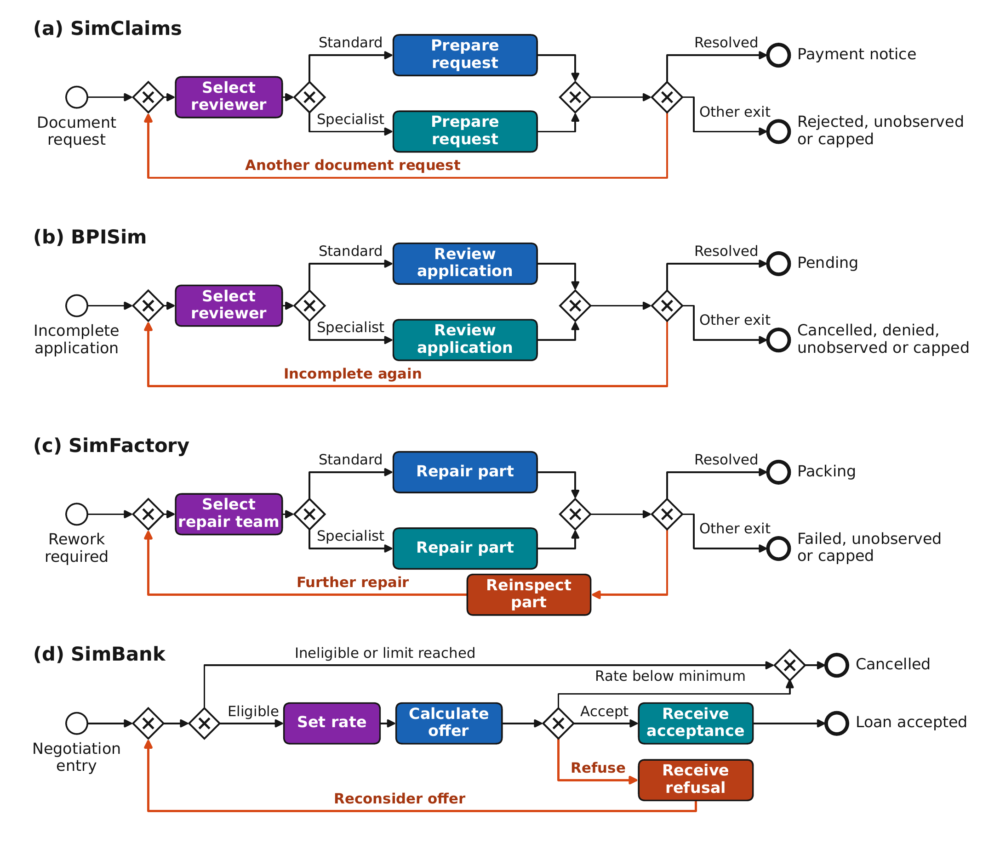

# LoopLab:

### **Demonstration Website: [https://github.com/WhiteMetagross/LoopLabWebsite](https://github.com/WhiteMetagross/LoopLabWebsite)**

LoopLab studies learning based interventions for rework, loops and repeated decisions in business processes. It compares deterministic rules, four machine learning families and four reinforcement learning families under matched simulator draws. The release contains only the code path used for the final paper results. Superseded pilots, discarded result generators, downloaded data, trained models and run artifacts are excluded.



## Research question:

Can sequential control improve a strong supervised policy when repeated work competes for limited capacity?

The study uses four settings:

- SimClaims models repeated document requests in insurance claims.

- BPISim models incomplete loan application reviews.

- SimFactory models repair followed by reinspection.

- SimBank models repeated loan offers after refusal.

The first three simulators are calibrated from event logs. SimBank uses its released process generator. Specialist effects in the three routing simulators are declared simulation assumptions.

## Main evidence:

The common screen compares FIFO or the released bank rule with Regression, Random Forest, CatBoost, XGBoost, Q learning, fitted Q, CQL and PPO. Focused controllers then use Regression forecasts so the sequential control effect is measured against one matched supervised policy.

The paper reports these focused effects:

| Simulator | Primary effect | Other effect |
| --- | ---: | ---: |
| SimClaims | 11.25% less queue time. | 0.322 more attempts per 100 cases. |
| BPISim | 0.11% less elapsed time. | The interval crosses zero. |
| SimFactory | 7.30% less tail wait. | 0.405 more repairs per 100 jobs. |
| SimBank | 22.95% fewer refusals. | No confirmed native profit change. |

These values are simulation results. They are not causal estimates for the source organizations.

## Repository structure:

```text
configs/             Locked experiment and data specifications.
paper/               IEEE LaTeX source, figures, tables and built PDF.
scripts/             Data acquisition, experiment runners, audits and artifact builders.
src/                 Simulator, forecasting and reinforcement learning modules.
tests/               Focused unit and invariant tests.
environment.yml      Main WSL Conda environment.
environment-torch.yml Shared Torch environment used by the experiment runners.
run_all.bat          One entry point for smoke or full reproduction.
```

Generated `data/`, `external/`, `runs/`, `report/` and `tmp/` directories are ignored by Git.

## Requirements:

- Windows 10 or 11 with WSL 2.

- Miniconda or Anaconda inside WSL.

- Git inside WSL.

- An NVIDIA GPU is optional. CPU execution remains supported.

- MiKTeX is required only to rebuild the PDF on Windows.

Create the project environments inside WSL:

```bash
conda env create -f environment.yml
conda env create -f environment-torch.yml
```

The environment names are part of the runner contract. Do not install packages into Conda `base`.

## One command reproduction:

Run the short integration check from Windows:

```bat
run_all.bat smoke
```

Run every final experiment, rebuild Tables II to IV, rebuild Figures 2 and 3 then compile the paper:

```bat
run_all.bat full
```

With no argument, `run_all.bat` uses `full` mode. The full run launches all stages in sequence. It does not launch four unrelated shells. This ordering is required because later ablations consume frozen predictors from earlier stages.

The first run downloads the three public event logs, checks their SHA256 values, clones SimBank at commit `ac25e116c3d9a9bed3bf6aec0fd101baef0891ef` then checks the released parameter file. The full run uses three random seeds generated from master seed 17. Seeds are not hard coded as an independent list.

On the reference system, the full chain required about two and a half hours. Runtime depends on CPU speed, storage and GPU availability. The smoke chain takes about two minutes after data acquisition.

## Reproduction stages:

The batch runner performs these stages:

1. Acquire data and verify pinned checksums.

2. Run the focused unit and invariant tests.

3. Run the common model and controller screen.

4. Run the focused Regression plus reinforcement learning comparison.

5. Run the timing, safety and profit refinements.

6. Run the component, reward, logging and burst ablations.

7. Audit seed identities, paired arrays, arm counts, source hashes and held out stream separation.

8. Build the final tables and figures from audited full outputs.

9. Compile the IEEE paper with MiKTeX.

Run artifacts appear under `runs/reproduction/`. They are intentionally excluded from version control because they contain generated arrays, fitted models and logs.

## Data provenance:

| Simulator | Source | Local role |
| --- | --- | --- |
| SimClaims | German insurance claims event log, DOI `10.17632/kdcspz6xtn.1`. | Document request episodes. |
| BPISim | BPI Challenge 2017, DOI `10.4121/uuid:5f3067df-f10b-45da-b98b-86ae4c7a310b`. | Incomplete review episodes. |
| SimFactory | Manufacturing production event log, DOI `10.4121/uuid:68726926-5ac5-4fab-b873-ee76ea412399`. | Repair and reinspection episodes. |
| SimBank | SimBank v1.0.0 and its 100,000 case interest rate parameter family. | Repeated offer decisions. |

Raw data licenses remain controlled by their publishers. The acquisition code records source URLs, fixed checksums and file size limits. No raw event log is stored in this repository.

## Paper:

The final manuscript is available at [paper/build/LoopLab.pdf](paper/build/LoopLab.pdf). Its LaTeX source is [paper/LoopLab.tex](paper/LoopLab.tex). The conclusion connects directly to this repository.

## Verification status:

The release smoke command completed locally. It passed 29 unit tests, all four simulator stages and the Regression ablation integrity audit. The audit checked 47 policy arms and 26 contrasts for the smoke seed. Regenerating the manuscript assets from saved full outputs matched all three table files exactly. Figure 3 matched exactly. Figure 2 reproduced the same values, dimensions and visible design. A byte identical Figure 2 PNG was not obtained because the rendered pixels differ on about 0.29% of positions, mainly antialiasing boundaries.

This is artifact consistency evidence. It is not an independent reproduction on another machine.

## Team:

Group Number 7.

- Mridankan Mandal, IIB2024017.

- Aditya Pachauri, IIB2024001.

- Dhannu Ram Meena, IIB2024033.
